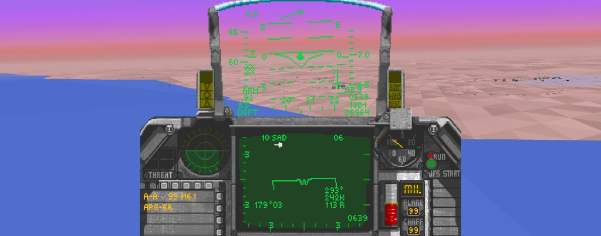
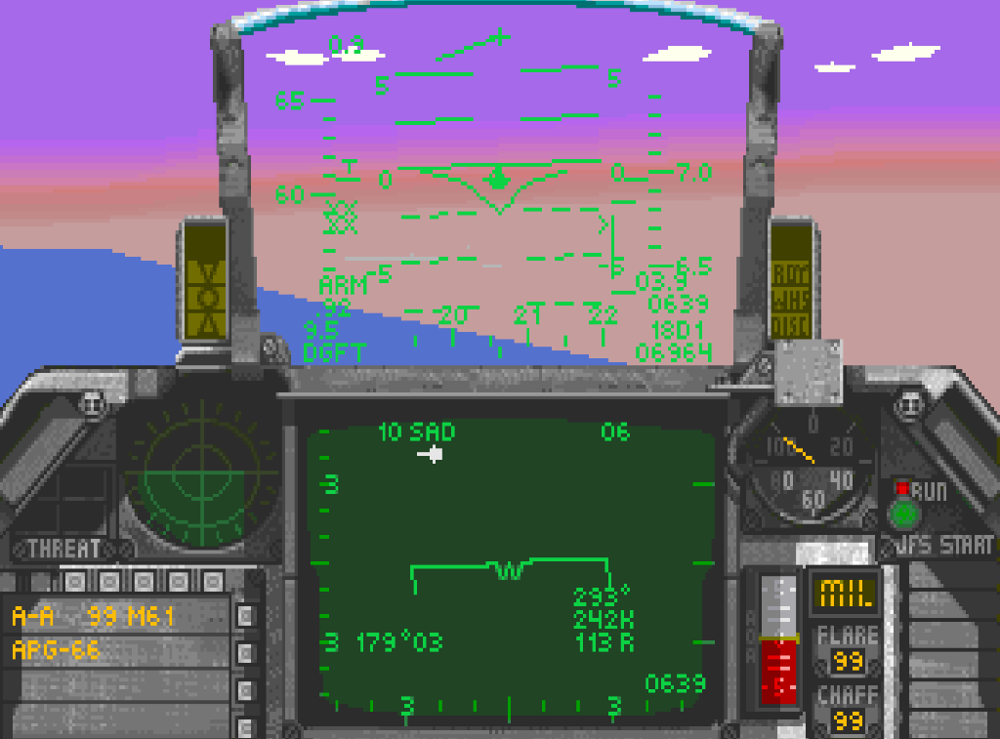

# Falcon 3.0 Gold — Native Host ("Ship of Theseus")

A standalone C++20 native host (SDL3 + OpenGL + Dear ImGui + Munt `libmt32emu` + `libx86emu`) that runs the original 1992 **Falcon 3.0 Gold** MS-DOS binaries directly on modern Windows outside of DOSBox — upgrading rendering, 3D cockpit/padlock, audio, flight physics, multi-HOTAS input, and networking while keeping Falcon's authentic HUD, radar, weapons, AI, and dynamic campaign 100% intact.

> **Legal Notice:** This repository contains **only original C++ host source code**. No copyrighted Spectrum HoloByte / MicroProse game binaries, data files, or Roland CM-32L / MT-32 ROMs are included. You must supply your own legally owned **Falcon Gold** installation (e.g., [GOG.com](https://www.gog.com/) or original CD-ROM) and your own Roland CM-32L / MT-32 ROMs.

---

## Before & After (Identical In-Flight Frame)

### After — Native Host (Hybrid HD 3D Widescreen)
60+ FPS OpenGL 3D world, 14-band live `ALTPAL` sunset, faceted desert, coastline & 3D buildings, with Falcon's real 2D HUD, MFD & RWR locked 1:1:



### Before — Classic 1991 VGA (`320×200`, 4:3)
Original 4:3 DOS software renderer:



---

## Highlights

- **4 Live Render Modes (`F11` cycles Classic VGA → Modern 3D → Hybrid Cockpit → VR Stereo Preview):**
  - **Hybrid Cockpit:** Crisp original 4:3 Falcon 3.0 2D cockpit & live HUD over the HD 3D world, with a **`Fill Widescreen 3D World`** toggle that expands raw 3D sky, terrain, clouds, bandits, and SAMs across your full 16:9 / ultrawide window while keeping the center 4:3 cockpit & HUD 100% 1:1 pixel-locked.
  - **Modern 3D:** Full 16:9 3D Virtual F-16 Cockpit (live 2D HUD/MFD/RWR center + Left/Right Aux panels + Front Live 4×8 Warning Matrix + Live Backup ADI/HSI pedestal) or pure HUD-only view.
  - **Unclamped 3D Padlock (`8`) inside 360° Retro Pixel-Art Cockpit:** Harvests all 4 native cockpit views (`3`/`4`/`6`/`5`) live from your running game into a 360° 3D F-16 cockpit with **real live 2D HUD + MFD + RWR** on the 3D glass, matching pixel-art top Padlock strip, and a **Red X-Ray Target Box** when targets dive below the canopy sill. Press `8` to lock/cycle threats (`Shift+8` reverses), `3` to return forward. Also supports **Right-Mouse Drag Free-Look** (Middle-Click recenters).
  - **Native 3D Theaters & Auto-Detection:** Renders Falcon's native `ALT.*`, `ISLDAT.*`, `MAPOBJ.*`, `ILS.*`, `ALTPAL.*`, `OBJECTS`, and `MAPOBJ` files with automatic theater switching across all 8 theaters (Kuwait, Bosnia, Israel, Korea, Panama, Nellis, Japan, India/Pakistan), 14-band live `ALTPAL` Day/Sunset/Dawn/Night skies, stars, runway lights, and city glow.
  - **3D Combat Visuals & Why485 / BMS Smart Scaling:** Long-range SAM/AAM rocket flares & billboarded smoke trails (25+ NM), 3D retro fireballs & airbursts, high-altitude wingtip contrails, 3D chaff/flares/M61 tracers, and live-selectable `Why485` / `Serfoss 2003` Smart Scaling.
- **64-Voice Telemetry-Driven & 3D Spatial CM-32L Audio Engine (`F12 → Audio`):**
  - Uses your own legally owned Roland CM-32L / MT-32 ROMs via embedded Munt `libmt32emu`. Pre-bakes Falcon's live `MUSIC/Y.MID` 83-SysEx SFX bank in RAM on flight entry for zero partial stealing and zero DOS 3-slot cutouts (reliable M61 Vulcan, missile launch whooshes, alternating ALE-40 chaff/flares, Doppler jet flybys, and SB16 radio comms with automatic engine ducking).
- **Multi-HOTAS Mapper & Zero-Calibration Bypass (`F12 → HOTAS Mapper`):**
  - Unlimited simultaneous USB sticks, throttles, rudder pedals, and button boxes with deadzone/invert/curve tuning, pinky shift layer, delta (rising-edge) capture (ignores always-ON toggle switches), JSON profiles, and automatic bypass of Falcon's 1991 joystick calibration wizard.
- **Optional 240 Hz Native F-16C Block 30/40 Flight Model Mod (`F12 → Flight Model Mod`):**
  - NASA TP-1538 aero + GE F110 / P&W F100 thrust curves + 1G auto-trim FLCS synced live into Falcon's HUD, radar, and weapons.
- **Live Non-Destructive SAM Realism Mod:** Patches Falcon's 16-missile RAM table at runtime (never modifies `.EXE` files on disk) to fix vanilla's infamous 80× SA-7 agility bug.
- **Modern UDP Multiplayer Bridge (`F12 → Multiplayer`):** Bridges Novell IPX (`INT 7Ah`) over UDP/IP with a built-in Host/Join lobby.
- **Fast-Boot Skip Intro:** Boots straight to the War Room in ~1.8 seconds while loading all 83 `Y.MID` CM-32L patches.

---

## Quick Start (GOG Falcon Gold + Munt ROMs)

You do **not** need to move or copy your GOG installation or your Munt ROMs — `falcon30_native.exe` can point directly to wherever they already live on your hard drive.

### 1. Locate Your GOG Falcon Gold Folder & Munt ROMs
- **GOG Falcon Gold:** Usually installed at `C:\GOG Games\Falcon Gold` or `D:\GOG Games\Falcon Gold` (or `C:\Program Files (x86)\GOG Galaxy\Games\Falcon Gold`). You can point directly at either the top-level `Falcon Gold` folder **or** the `FALCON3` subfolder containing `FALCONCD.EXE`.
- **Roland CM-32L / MT-32 ROMs (Munt):** Any folder containing `CM32L_CONTROL.ROM` + `CM32L_PCM.ROM` (recommended for Falcon 3.0) or `MT32_CONTROL.ROM` + `MT32_PCM.ROM`.

### 2. Launch with Your Existing Folders (Recommended)

**Option A — Create a one-click `launch_falcon3.bat` next to `falcon30_native.exe`:**
```bat
@echo off
start "" "%~dp0falcon30_native.exe" ^
  --game-dir "D:\GOG Games\Falcon Gold" ^
  --rom-dir "E:\Path\To\Munt_ROMS\cm32l"
```
*(Adjust the two paths to match your own hard drive. Double-click `launch_falcon3.bat` to play!)*

**Option B — PowerShell / Command Line:**
```powershell
.\falcon30_native.exe --game-dir "D:\GOG Games\Falcon Gold" --rom-dir "E:\Path\To\Munt_ROMS\cm32l"
```

**Option C — Environment Variables (set once, then just double-click `falcon30_native.exe`):**
```powershell
setx FALCON3_GAME_DIR "D:\GOG Games\Falcon Gold"
setx MT32_ROM_DIR     "E:\Path\To\Munt_ROMS\cm32l"
```
*(You can also change or reload your ROM folder anytime in-game via **`F12 → Audio → ROM Folder → Reload CM-32L ROMs`**.)*

**Option D — Local Folder Drop-In (Portable):**
- Copy your GOG `FALCON3` files into a `game_data/` folder next to `falcon30_native.exe`, and your CM-32L/MT-32 `.ROM` files into a `roms/` folder next to `falcon30_native.exe`. Then just double-click `falcon30_native.exe`.

> **Auto-Detection:** Even without flags, `falcon30_native.exe` automatically checks `./game_data`, `C:\GOG Games\Falcon Gold`, `D:\GOG Games\Falcon Gold`, `E:\GOG Games\Falcon Gold`, and `GOG Galaxy\Games\Falcon Gold`, plus `./roms`, `%APPDATA%\munt\roms`, and `C:\munt\roms`.

---

## Supported Game Files & SHA-256 Verification

| Executable | Title | Exact Size | Expected SHA-256 |
|---|---|---:|---|
| `FALCONCD.EXE` | Falcon 3.0 (F-16C) *(Required)* | 1,373,671 B | `0c51f01bb167fe6bf48d8d386482258fba7dbab920625d589352321ce44298f3` |
| `HORNETCD.EXE` | Hornet: Naval Strike *(Optional)* | 1,412,635 B | `4322ca4cdd838b15fb5e4d5d8f4cee762b7eaaf75792bbd6ca6c80f5751c5d72` |
| `MIGCD.EXE` | MiG-29: Deadly Adversary *(Optional)* | 1,369,383 B | `ae67a76fb4b43856d701bd1018f2931f9b55b59926f320fb90b46ff47868a80a` |

Optional verification script:
```powershell
python scripts/verify_game_data.py "D:\GOG Games\Falcon Gold\FALCON3" --rom-dir "E:\Path\To\Munt_ROMS\cm32l"
```
`falcon30_native.exe` also verifies the loaded executable's SHA-256 automatically on startup and logs the result in `F12 → RE Debugger`.

---

## Building from Source

### Prerequisites
- CMake 3.22+ and Ninja (or Visual Studio / Make)
- C++20 compiler (MinGW-w64 GCC 13+ on Windows, or MSVC 2022)
- Internet access on first configure (CMake `FetchContent` pulls SDL3, Dear ImGui, `libx86emu`, `libmt32emu`, and `nlohmann/json`)

### Build (Windows / PowerShell)
```powershell
cmake -S recomp -B recomp/build -G Ninja -DCMAKE_BUILD_TYPE=Release
cmake --build recomp/build --parallel

# Run pointing directly at your GOG Falcon Gold install + Munt ROMs:
.\recomp\build\falcon30_native.exe --game-dir "D:\GOG Games\Falcon Gold" --rom-dir "E:\Path\To\Munt_ROMS\cm32l"
```

### CLI Flags
| Flag | Description |
|---|---|
| `--game-dir <path>` | Path to your Falcon Gold install folder (root or `FALCON3` subfolder) |
| `--rom-dir <path>` | Path to your Roland CM-32L / MT-32 `.ROM` folder |
| `--exe <name>` | Launch `FALCONCD.EXE` (default), `HORNETCD.EXE`, or `MIGCD.EXE` |
| `--test-fastboot` | Headless fast-boot smoke test (~1.8 s) |
| `--trace-audio` | Log MIDI / SysEx / ROM sample baking diagnostics |

---

## Quick Controls

| Key | Action |
|---|---|
| `F11` | Cycle Render Mode (`Classic VGA` → `Modern 3D` → `Hybrid Cockpit` → `VR Stereo`) |
| `F12` | Toggle Native Settings Overlay (3D/VR, Flight Model, HOTAS, Audio, Multiplayer, Debugger) |
| `8` / `Shift+8` | Unclamped 3D Padlock (lock/cycle threats with live 2D HUD + MFD/RWR + X-Ray Box) |
| `3` | Forward Cockpit (exits Padlock & recenters head look) |
| `Right-Mouse Drag` | Smooth 360° 3D Cockpit Free-Look (`Middle-Click` or `3` recenters) |
| `Space` | Fire Selected Weapon (single-shot tap for missiles/bombs, hold for M61 Vulcan) |
| `Enter` / `Backspace` | Cycle Air-to-Air / Air-to-Ground Weapon |
| `Insert` / `Delete` | Dispense Chaff / Dispense Flare |
| `Z` / `X` / `T` | Radar Lock (STT) / Unlock / Cycle Target |
| `+` / `-` / `/` / `,` / `.` | Throttle Up/Down, Afterburner Toggle & AB1–AB5 Stages |
| `1` / `2` / `4` / `5` / `6` / `7` / `9` / `0` | External Chase, Ground, Left/Rear/Right Cockpit, Track, Enemy, Orbit Views |

---

## Documentation & Roadmap

- [recomp/HANDOFF.md](recomp/HANDOFF.md) — Technical architecture, reverse-engineered RAM/asset map, and solved low-level pitfalls.
- [recomp/HORNET_MIG_PORTING_GUIDE.md](recomp/HORNET_MIG_PORTING_GUIDE.md) — Step-by-step guide to bring `HORNETCD.EXE` and `MIGCD.EXE` to full native 3D, HUD, carrier, and flight-model parity.

## License

Host source code is released under the [MIT License](LICENSE).
